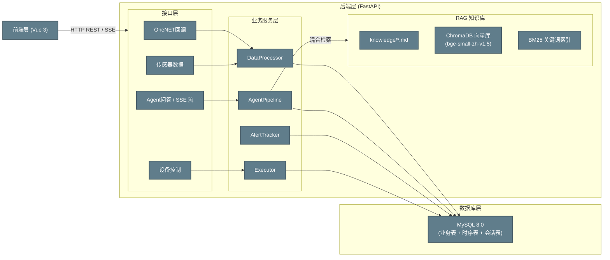
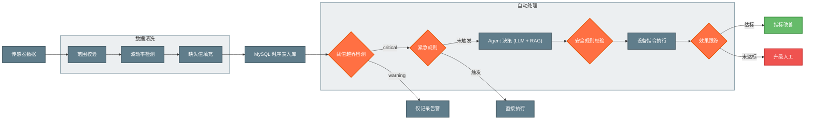

# 鱼跃云门智慧渔业养殖管理系统后端

基于 **IoT + AI Agent + RAG** 的智慧渔业养殖管理系统后端。从硬件/模拟器实时接收水质数据，清洗入库，前端轮询展示；水质异常时由 LLM Agent 自主分析决策，自动下发设备控制指令；异常持续超过 1 小时自动升级为人工处理。养殖问答基于本地知识库做混合检索增强，支持 SSE 流式输出与多轮会话持久化。另提供 `eval/` 离线检索评测与 `mcp_server/` 只读 MCP 接入。

## 系统架构



## 核心流程



## 核心功能

| 模块 | 说明 |
|------|------|
| 数据接收 | OneNET 平台 URL 验证 + 数据推送回调 |
| 数据清洗 | 范围校验（7项指标）、波动率检测（突变>50%告警但不丢弃）、滑动窗口均值填充 |
| 传感器数据 | 7 项指标：温度、pH、溶解氧、氨氮、亚硝酸盐、浊度、水位 |
| 三层防御 | 紧急规则（绕过 LLM 直接执行）→ Agent 决策（LLM 智能分析）→ 安全规则（执行前拦截） |
| Agent 决策 | ReAct 循环自主调用只读工具（水质 / 趋势 / 设备 / 知识库），经 `propose_action` 提议动作，Guard 校验后统一执行 |
| 规则引擎 | 5 条紧急规则 + 6 条安全规则 + 3 条效果跟踪规则，确保设备和鱼类安全 |
| 设备控制 | 增氧机/水泵/投饵机开关控制，冷却期保护（落库，5分钟）+ 人工指令同样过安全规则 + 高风险动作需确认 |
| 效果跟踪 | 指令执行后 15 分钟自动检查指标改善情况，未达标自动升级 |
| 告警追踪 | APScheduler 每 30 秒扫描活跃告警，超过 60 分钟自动升级人工工单 |
| 告警恢复 | 连续 3 个采样点正常后自动关闭活跃告警，另有 5 分钟兜底扫描 |
| 人工工单 | pending → processing → resolved 状态流转，防重复创建 |
| 知识库问答 | `knowledge/` 下 10 篇养殖文档的混合检索（向量 + BM25 → RRF 融合），回答附参考来源片段与相似度 |
| 流式问答 | `POST /api/agent/chat/stream` 以 SSE 推送参考来源与增量文本，非流式接口保留供前端降级 |
| 会话管理 | `chat_sessions` / `chat_messages` 持久化多轮对话，支持会话列表、历史回放、删除，按登录用户隔离 |
| 上下文预算 | 历史消息按字符裁剪、RAG 上下文截断、告警上下文降采样，避免长上下文撑爆提示词 |
| 健康度监控 | 后台统计 `agent_runs` 的 fallback 占比，LLM 侧整体退化时告警并暴露到 `/health` |
| 数据模拟器 | asyncio + aiohttp，正弦波模拟水质日变化，支持 6 种异常注入场景 |
| MCP 接入 | `mcp_server/` 以 stdio 暴露 6 个只读工具（知识检索 / 水质快照 / 趋势 / 设备 / 告警 / 阈值），不含任何设备控制入口 |
| 检索评测 | `eval/` 提供 42 条分层评测集与三路消融脚本，量化混合检索相对单路基线的真实收益 |

## 技术栈

| 分类 | 技术 | 说明 |
|------|------|------|
| 框架 | FastAPI | Python 异步 Web 框架 |
| 鉴权 | PyJWT (HS256) | Bearer Token，密码 pbkdf2_sha256 哈希 |
| 语言 | Python 3.12+ | — |
| 数据库 | MySQL 8.0 | 业务表 + sensor_data / device_status 时序表 + chat_sessions / chat_messages 会话表统一存放 |
| 时序查询 | execute_sql 适配层 | 兼容旧 REST 返回结构，底层走 MySQL 连接池，支持 %s 参数化 |
| LLM | 智谱 GLM-4.5 | OpenAI 兼容接口，可通过 .env 切换 |
| 向量检索 | ChromaDB + bge-small-zh-v1.5 | 本地持久化向量库（Cosine 距离），模型优先读 `models/bge-small-zh-v1.5` |
| 关键词检索 | jieba + rank-bm25 | 中文分词后建 BM25 稀疏索引，与向量结果按 RRF 融合 |
| 流式输出 | SSE | `text/event-stream`，逐帧推送 `meta` / `delta` / `error` / `done` 事件 |
| LLM 客户端 | 原生 openai SDK | OpenAI 兼容协议，问答与 Agent 共用一条调用路径 |
| 重试机制 | tenacity | 问答侧 LLM 调用指数退避重试（最多 2 次）；Agent 循环不单独重试 |
| 定时任务 | APScheduler | BackgroundScheduler 后台线程 |
| 部署 | 本地进程 | Python venv + 本机 MySQL 8.0 + Vite（不使用容器） |
| 模拟器 | aiohttp | 异步 HTTP 客户端上报数据（先登录取令牌再上报） |
| MCP | mcp SDK 2.x (`MCPServer`) | stdio 传输，只读工具暴露，供 Claude Desktop / Cline / Inspector 接入 |
| 测试 | pytest + pytest-asyncio | `pytest.ini` 已配置 `asyncio_mode = auto`，另有 pytest-benchmark 与 locust 性能脚本 |

## 快速开始（本地部署）

不使用容器，直接在本机运行：MySQL 8.0 + Python 3.12+ + Node.js 18+。RAG 依赖 ChromaDB 与本地 embedding 模型，首次启动会加载模型（占用约 100MB 内存）。

### 1. 准备本机 MySQL

安装并启动 MySQL 8.0（默认 `localhost:3306`），然后初始化库与全部 12 张表：

```bash
cd Backend
mysql -uroot -p < sql/fishery_mysql.sql
```

脚本使用 `CREATE TABLE IF NOT EXISTS` 与 `INSERT IGNORE`，可重复执行；包含业务表 10 张（含 `agent_runs`、`chat_sessions`、`chat_messages`）、`sensor_data` / `device_status` 两张时序表，以及 3 条设备映射与 4 台可控设备。

### 2. 创建虚拟环境并安装依赖

```bash
cd Backend
python -m venv venv
venv\Scripts\activate          # Windows；macOS/Linux 用 source venv/bin/activate
pip install -r requirements.txt
```

`requirements.txt` 已包含全部运行时依赖（含 RAG、Agent 与 MCP 组件），无需额外安装。

### 3. 配置环境变量

从 `.env.example` 复制为 `.env`（Windows 用 `copy`，macOS/Linux 用 `cp`），再按实际情况修改。

必须修改的三项：

```env
MYSQL_PASSWORD=你的本机 MySQL 密码
LLM_API_KEY=你的智谱 API Key
JWT_SECRET=改成一个长随机串
```

其余按需调整，常用项：

| 变量 | 默认 | 说明 |
|------|------|------|
| `ONENET_VERIFY_MODE` | `token` | 回调校验：`token` / `signature` / `any` / `none`（仅联调） |
| `LLM_MODEL` | `glm-4.5-flash` | 任意 OpenAI 兼容模型 |
| `RAG_ENABLED` | `true` | 关闭后问答与 Agent 退化为无知识注入 |
| `AGENT_MAX_STEPS` | `6` | 单次决策最多几轮工具调用 |
| `AGENT_TIMEOUT_SECONDS` | `45` | 单次决策墙钟预算 |
| `COOLDOWN_MINUTES` | `5` | 同一设备指令冷却期 |

完整变量清单以 `.env.example` 为模板、以 `app/core/config.py` 为语义准绳；README 不再重复罗列，避免两份清单漂移。

> `users` 表为空时，服务首次启动会自动创建 `admin / admin123`，
> 登录后请立刻在右上角用户菜单里修改密码。

### 4. 构建 RAG 向量索引（推荐）

知识库位于 `Backend/knowledge/`，按 `water_quality/`、`diseases/`、`breeding/` 三类组织，共 10 篇 Markdown 文档。索引需手动构建一次，知识文档变更后要重建：

```bash
cd Backend
python -m app.rag.build_index            # 增量构建（按 source 先删后加）
python -m app.rag.build_index --reset    # 全量重建（清空 ChromaDB 后重新索引）
```

构建流程：按 Markdown 标题层级切块（`chunk_size=500`、`overlap=50`）→ `bge-small-zh-v1.5` 批量向量化 → 写入 `Backend/chroma_data/`。模型优先加载 `Backend/models/bge-small-zh-v1.5/`，目录缺失时才回退在线下载，内网环境建议保留该目录。

未构建索引、依赖缺失或模型加载失败时，RAG 会自动降级为空结果（日志记 warning），问答与 Agent 决策仍可运行；具体缺哪个依赖可通过 `GET /health` 的 `agent.rag_dependencies` 查看。

### 5. 启动服务

```bash
# 后端（保持单进程）
cd Backend
python -m app.main

# 前端（另开终端）
cd ui
npm install
npm run dev

# 数据模拟器（可选，另开终端；默认用 admin/admin123 登录后上报）
cd Backend
python simulator.py --pond-id pond1 --interval 5 --anomaly-rate 0.05
```

> 必须用 `python -m app.main`：直接执行 `python app/main.py` 时 `sys.path[0]` 是 `Backend/app`，代码里的 `from app.xxx import ...` 绝对导入会报 `ModuleNotFoundError: No module named 'app'`。

| 服务 | 地址 | 说明 |
|------|------|------|
| 前端 | <http://localhost:3000> | Vite 开发服务器 |
| 后端 | <http://localhost:8000> | FastAPI |
| 接口文档 | <http://localhost:8000/docs> | Swagger UI |

> **必须单进程运行**：`app/main.py` 以单 worker 启动 uvicorn。APScheduler 在每个进程中都会启动，多进程会重复扫描告警、重复创建工单。

`lifespan` 启动时会预加载 BM25 索引与 embedding 模型，首次启动多等几秒；RAG 初始化失败只记 warning，不影响数据接收与告警链路。

### 6. 生产构建（可选）

```bash
cd ui
npm run build
```

产物在 `ui/dist/`，用 `npm run preview`、`npx serve dist` 或任意静态服务器托管。前后端不同源时，构建前设置 `VITE_API_BASE_URL` 指向后端，并把 `CORS_ORIGINS` 配成具体来源。

### 7. 验证

```bash
curl http://localhost:8000/health/live
curl http://localhost:8000/health/ready

# 单元 / Agent 契约 / 性能基准
cd Backend
pip install -r requirements-test.txt
pytest -q

# RAG 检索评测（可选，需已构建索引）
python -m eval.run_retrieval_eval

# RAG 检索质量门禁（默认跳过，需显式启用）
RUN_RAG_EVAL=1 pytest tests/agent/test_rag_eval.py -v
```

测试按 `tests/unit`（数据处理、规则、执行器、鉴权等）、`tests/agent`（Agent 不变量、dry-run、健康度、会话、流式、上下文预算、MCP 契约）、`tests/performance`（benchmark 与 locust 压测）分层，`conftest.py` 会设置 `TEST_MODE=true` 跳过真实数据库读写。RAG 检索评测依赖本地模型与 Chroma 索引，默认不进入常规批次。

### 8. 健康检查

| 路径 | 用途 |
|------|------|
| `GET /health/live` | 存活探针，只判断进程是否响应，不查依赖 |
| `GET /health/ready` | 就绪探针，检查 MySQL 中的时序表与业务表，任一异常返回 503 |
| `GET /health` | 依赖详情 + Agent 运行态（`agent` 下含 LLM 是否配置、RAG 依赖、fallback 占比、网关是否接线） |

## 防御体系

系统设计了三层防御架构，确保设备和鱼类安全。

### 第一层：紧急规则（最高优先级，绕过 LLM）

数据入库后立即检查，触发时直接执行，不经过 LLM：

| 条件 | 动作 |
|------|------|
| 溶解氧 < 1.0 mg/L | 立即开增氧机（最高功率 60 分钟） |
| 水温 > 35℃ | 立即开增氧机降温 |
| pH < 6.0 或 > 9.5 | 立即报人工 |
| 氨氮 > 1.0 mg/L | 立即开水泵换水 |
| 水位 < 0.5m | 立即报人工 |

### 第二层：Agent 决策（LLM 智能分析）

critical 级别告警触发，构建全局上下文（所有传感器 + 设备状态 + 近 10 分钟历史）→ ReAct 循环自主调用只读工具与 `search_knowledge` → 通过 `propose_action` 提议动作 → Guard 五道校验 → 统一执行出口。LLM 调用失败、超时、超预算或无合法提议时自动回退到 `FALLBACK_ACTIONS` 规则兜底。详见 [Agent 决策](#agent-决策)。

### 第三层：安全规则（执行前拦截）

| 规则 | 条件 | 动作 |
|------|------|------|
| DO 安全 | 溶解氧 < 3 mg/L | 禁止关闭增氧机/水泵 |
| 高温保护 | 水温 > 30℃ | 禁止关闭增氧机 |
| pH 保护 | pH < 6.5 或 > 8.5 | 禁止关闭水泵 |
| 高风险确认 | stop_aerator / stop_pump | 需人工确认 |

### 告警生命周期

```
active（活跃）──持续 60 分钟──▶ escalated（已升级，生成人工工单）
      │                                    │
      └──── 指标恢复正常 ◀─────────────────┘
                  │
                  ▼
             resolved（已关闭）
```

恢复判定不做单点判断：连续 `RECOVERY_CONSECUTIVE_POINTS`（默认 3）个采样点都正常
才关闭告警，避免溶解氧在 3.0 附近抖动导致告警反复开关。另有 5 分钟一次的兜底扫描
（`RECOVERY_SCAN_INTERVAL_SECONDS`），用最新传感器值重新检测，覆盖进程重启丢失计数
和历史遗留记录；最新数据超过 `RECOVERY_DATA_MAX_AGE_SECONDS` 视为设备离线，不做恢复判断。

告警关闭后 `manual_tasks` 中的工单仍然保留，由人工确认处理结果后关闭。

## 阈值配置

所有阈值集中在 `app/core/config.py`，按防线分层，避免多处硬编码不一致：

| 配置项 | 使用方 | 语义 |
|--------|--------|------|
| `ALERT_THRESHOLDS` | `detector` | 触发告警的临界值/预警值 |
| `EMERGENCY_THRESHOLDS` | `rules.check_emergency_rules` | 第一道防线，命中绕过 LLM 直接执行 |
| `SAFETY_THRESHOLDS` | `rules.check_safety_rules` | 执行前校验，拦截危险操作 |
| `EFFECT_THRESHOLDS` | `rules.check_effect_tracking_rule` | 执行后判断指标是否改善 |
| `FALLBACK_ACTIONS` | `decision._rule_based_decision` | LLM 不可用时按「指标 + 方向」查表 |

**告警阈值**：

| 指标 | 临界值 (critical) | 预警值 (warning) |
|------|-------------------|-------------------|
| 溶解氧 | < 3.0 mg/L | < 5.0 mg/L |
| 水温 | < 15℃ / > 32℃ | > 28℃ |
| pH | < 6.5 / > 8.5 | — |
| 氨氮 | > 0.5 mg/L | > 0.2 mg/L |
| 亚硝酸盐 | > 0.3 mg/L | > 0.1 mg/L |
| 浊度 | > 500 NTU | — |
| 水位 | < 1.0m / > 3.0m | — |

**趋势预警**：取最近 `TREND_WINDOW_POINTS`（默认 5）个采样点，仅当首尾变化幅度超过
`TREND_MIN_CHANGE_RATIO`（默认 3%）且整体方向单调时才触发，且同类趋势告警
`TREND_ALERT_REPEAT_WINDOW_SECONDS`（默认 600 秒）内只入库一次。

**规则兜底**：LLM 不可用时不再硬编码数值判断，而是按 `FALLBACK_ACTIONS` 查表，
例如 `dissolved_oxygen` + `low` → 开增氧机，`ammonia_nitrogen` + `high` → 开水泵。
阈值判断由 detector 完成，规则表只负责「指标 + 越界方向 → 动作」的映射。

## Agent 决策

决策链路唯一：告警触发后构建全局上下文（所有传感器 + 设备状态 + 近 10 分钟历史）→ ReAct 循环（只读工具 + `propose_action`）→ Guard 五道校验 → `tools/executor.execute_with_check()` 唯一执行出口。任何异常、超时、超预算或无合法提议，都降级到 `FALLBACK_ACTIONS` 规则兜底，并写一条 `agent_runs` 审计记录。

不再有模式开关：`AGENT_MODE` 已移除，旧 `legacy` 单次 LLM 决策链路与 `shadow` 观察模式均已删除。`agent_runs.mode` 列保留，历史数据可能含这两类值，新记录固定为 `react`。

核心不变量：**LLM 只有提议权，执行器保留否决权**。紧急规则（`data_processor` 同步路径）永不进入 Agent；Agent 只注册 4 个只读工具与 `propose_action`；所有动作必须经 `tools/executor.execute_with_check()`。

首次部署须先执行 `sql/fishery_mysql.sql`（含 `agent_runs`）、装齐 RAG 依赖并构建索引，然后运行 `python scripts/verify_llm_backend.py` 验证 GLM 的 function calling 兼容性。设计约束见 `app/agent/__init__.py` 模块注释，硬件接线说明见 `app/agent/gateway.py`。

### 健康度监控

LLM 侧整体退化（模型不收敛、tool_calls 失效、持续超时）会表现为 `agent_runs.outcome='fallback'` 占比抬升。此时设备仍由规则兜底接管、不会停摆，因此这类退化是静默的。后台每 `AGENT_HEALTH_SCAN_SECONDS`（默认 300s）统计一次最近 `AGENT_FALLBACK_WINDOW_MINUTES`（默认 30 分钟）的占比：样本数达到 `AGENT_FALLBACK_MIN_SAMPLES`（默认 10）且占比超过 `AGENT_FALLBACK_RATIO_THRESHOLD`（默认 0.5）时记一条 warning，并在 `GET /health` 的 `agent.decision_health` 字段暴露。统计结果缓存在进程内，`/health` 不查库；只在跨阈值时打日志，不会刷屏。

### 离线回放（灰度验证）

改 prompt、换模型或调预算后，用历史告警重跑一遍，只提议不执行：

```bash
python scripts/replay_agent.py --limit 20
python scripts/replay_agent.py --alert-type dissolved_oxygen_low --since-hours 72 --json
```

回放调用 `run_agent(execute=False)`：完整跑循环与 Guard 校验，把「若执行会做什么」写进 `final_actions`，`outcome` 标为 `dry_run`，不触碰执行器。生产路径永远 `execute=True`，该参数不暴露为配置项。回放使用**当前**数据库状态重建上下文（`agent_runs` 未保存历史 context），适合验证同类告警下的提议质量，不做逐字节历史重演。

## RAG 知识库与检索评测

`eval/` 提供离线评测工具，用于量化「混合检索是否真的优于单一检索」，
并作为改动检索逻辑时的回归门禁 —— 而不是只靠注释里的经验判断。

### 评测集

`eval/dataset/retrieval_cases.jsonl`，42 条人工标注，按查询类型分三桶：

| 桶 | 数量 | 特征 | 示例 |
|---|---|---|---|
| `exact` | 18 | 精确术语，BM25 强项 | "烂鳃病的病原菌是什么" |
| `paraphrase` | 14 | 口语 / 同义改写，向量强项 | "鱼身上长了一层白白的毛" |
| `multi_hop` | 10 | 跨文档，需覆盖 2 篇 | "氨氮高同时 pH 也高先处理哪个" |

每条标注 `relevant_sources`（相关文档）与 `keywords`（相关段落必含词），
用于 chunk 级命中判定；`multi_hop` 额外标 `min_sources=2`。

### 运行

```bash
cd Backend
python -m eval.run_retrieval_eval                        # 默认沿用 RAG_TOP_K / RAG_SCORE_THRESHOLD
python -m eval.run_retrieval_eval --top-k 5
python -m eval.run_retrieval_eval --json                 # 机器可读输出，供 CI 使用
python -m eval.run_retrieval_eval --gate-hit-rate 0.8    # 低于阈值退出码 1
```

脚本默认读取 `.env` 中的 `RAG_TOP_K` 与 `RAG_SCORE_THRESHOLD`，保证评测口径与线上一致；
向量相似度阈值仅作用于向量命中，与 `retrieve()` 内部实现保持一致。

### 基线结果

`top_k=3`、`score_threshold=0.5`（线上默认配置）：

| 策略 | Hit@3 | Recall@3 | MRR@3 |
|------|-------|----------|-------|
| 纯向量 | 0.714 | 0.786 | 0.635 |
| 纯 BM25 | 0.810 | 0.857 | 0.631 |
| **RRF 混合** | **0.810** | **0.857** | **0.722** |

**结论：混合检索的价值在排序质量而非命中率。** 相对纯向量 Hit@3 提升 9.5pt，
但相对纯 BM25 的 Hit@3 为 +0.0pt；MRR 则同时优于两路单检（+8.7pt / +9.1pt），
且两个桶各自的 MRR 都超过对应单路冠军（exact 0.972 > 0.935，paraphrase 0.786 > 0.726），
这才是双路互补的直接证据。

**已知问题**：`multi_hop` 桶上混合检索的 Recall（0.600）低于纯 BM25（0.700）。
原因是 RRF 融合会让同一文档的多个 chunk 挤占候选位，属于 RRF 的已知副作用，
可通过「文档级配额」（每篇文档最多保留 1~2 个 chunk）缓解，尚未实施。

### 回归门禁

```bash
RUN_RAG_EVAL=1 pytest tests/agent/test_rag_eval.py -v
```

默认跳过（依赖本地 embedding 模型与已构建索引）。四条断言：整体 Hit@k 不低于门禁下限、
不劣于单路最优、MRR 严格优于任一路、任一桶退化不超过 10pt。

## API 接口

基础路径：`/api/`（OneNET 回调为 `/onenet/`，健康检查为 `/health`）

### 认证

除 `/api/auth/login`、`/onenet/callback`、`/health/*` 外，所有接口都要求携带令牌：

```
Authorization: Bearer <token>
```

| 方法 | 路径 | 说明 |
|------|------|------|
| POST | `/api/auth/login` | 登录，返回 JWT 与用户信息 |
| GET | `/api/auth/me` | 获取当前登录用户 |
| POST | `/api/auth/change-password` | 修改当前用户密码 |

**登录请求**：

```json
{ "username": "admin", "password": "admin123" }
```

**登录响应**：

```json
{
    "success": true,
    "token": "eyJhbGciOiJIUzI1NiIs...",
    "user": { "username": "admin", "display_name": "系统管理员", "role": "admin" }
}
```

令牌有效期由 `JWT_EXPIRE_MINUTES` 控制（默认 12 小时）。密码以 pbkdf2_sha256 加盐哈希存储，数据库中不保存明文。

### OneNET 回调

| 方法 | 路径 | 说明 |
|------|------|------|
| GET | `/onenet/callback` | URL 验证（MD5 签名校验） |
| POST | `/onenet/callback` | 数据接收（自动识别传感器数据/设备状态） |

**推送鉴权**：POST 默认要求携带平台令牌，三种方式任选：

```bash
# 方式一：请求头
X-OneNET-Token: <ONENET_TOKEN>
# 方式二：Bearer
Authorization: Bearer <ONENET_TOKEN>
# 方式三：URL 参数
POST /onenet/callback?token=<ONENET_TOKEN>
```

校验模式由 `ONENET_VERIFY_MODE` 控制：`token`（默认）/ `signature`（仅 MD5 签名）/
`any`（任一通过）/ `none`（关闭，仅本地联调）。平台推送未配置凭据时会返回 401，
接入真实设备时记得在 OneNET 侧同步配置。

### 传感器数据

| 方法 | 路径 | 说明 |
|------|------|------|
| GET | `/api/sensor-data` | 查询最新数据（默认最近 1 分钟，无数据回退最近 10 条） |
| GET | `/api/sensor-data/history` | 历史查询（必填 pond_id、start、end，可选 metrics） |
| POST | `/api/sensor-data/simulator/data` | 模拟器数据接入 |

### Agent 问答

| 方法 | 路径 | 说明 |
|------|------|------|
| POST | `/api/agent/chat` | 一次性问答（RAG 增强 + 多轮上下文），返回 `reply` 与 `sources` |
| POST | `/api/agent/chat/stream` | SSE 流式问答，先推参考来源再逐块推正文 |
| POST | `/api/agent/sessions` | 新建会话，返回服务端生成的 `session_id` |
| GET | `/api/agent/sessions` | 当前用户的会话列表（标题取第一条提问） |
| GET | `/api/agent/sessions/{id}/messages` | 回放会话消息（供前端刷新后恢复） |
| DELETE | `/api/agent/sessions/{id}` | 删除会话及其全部消息 |
| GET | `/api/agent/decisions` | Agent 决策记录（关联告警信息） |

**对话请求**：

```json
{ "message": "当前水质怎么样？", "session_id": "可选，传入后启用多轮上下文" }
```

`sources` 中每项包含 `source`、`category`、`title`、`score`（向量余弦相似度）与 `content`（召回片段原文），供前端展示「回答依据」。会话与登录用户绑定，读取他人 `session_id` 返回 403。

**流式事件**（`text/event-stream`，响应头已关闭代理缓冲）：

| 事件 | 数据 | 说明 |
|------|------|------|
| `meta` | `{"sources": [...]}` | RAG 参考来源，先于正文到达 |
| `delta` | `{"content": "..."}` | LLM 增量文本，前端按帧渲染 Markdown |
| `error` | `{"message": "..."}` | 生成失败提示，已生成内容保留 |
| `done` | `{"ok": true/false}` | 结束标记 |

流式调用不做自动重试（已推送内容无法撤回），前端在建立流失败时会降级到 `/api/agent/chat`。

### 告警管理

| 方法 | 路径 | 说明 |
|------|------|------|
| GET | `/api/alerts/active` | 活跃告警列表（含持续时长、Agent 决策摘要） |
| GET | `/api/alerts/escalated` | 已升级告警列表 |

### 人工工单

| 方法 | 路径 | 说明 |
|------|------|------|
| GET | `/api/manual-tasks` | 工单列表（支持 status、pond_id 筛选） |
| POST | `/api/manual-tasks/{id}/process` | 标记处理中（status → processing） |
| POST | `/api/manual-tasks/{id}/resolve` | 标记已处理（status → resolved） |

### 设备控制

| 方法 | 路径 | 说明 |
|------|------|------|
| GET | `/api/control-devices` | 设备列表（支持 pond_id 筛选） |
| POST | `/api/control-devices/{identifier}/command` | 手动下发控制指令 |

**下发指令**：

```json
{
    "command_type": "start_aerator",
    "params": { "duration": 30 }
}
```

**可用指令**：`start_aerator` / `stop_aerator`（增氧机）、`start_pump` / `stop_pump`（水泵）、`start_feeder` / `stop_feeder`（投饵机）

人工指令与 Agent 指令走同一个执行器，同样经过安全规则校验：

- 前端二次确认过的动作视为「人工已确认」，可以执行 `stop_aerator` / `stop_pump` 这类高风险动作
- 但硬性安全规则不可绕过：例如溶解氧 < 3 mg/L 时关闭增氧机，会返回
  `{"success": false, "message": "指令被安全规则拦截：..."}`
- 人工指令不受 5 分钟冷却期限制（紧急场景需要立即操作），Agent 指令仍受冷却期保护

### 决策闭环边界与硬件接线点（当前 demo 范围）

**闭环终点**：传感器异常 → 告警 → 决策（含 reason）→ 安全闸门 → 写入
`device_commands` → 前端「最近指令记录」可见。**硬件执行不在本期范围内**，
只保留 `app/agent/gateway.py` 的 `DeviceGateway.dispatch` 接口与桩实现。

| 项 | 当前语义 |
|---|---|
| `device_commands.result` | `[STUB] 指令已登记，DeviceGateway.dispatch 未接线（硬件未接入）`，不宣称执行成功 |
| `device_commands.status` | `executed` 表示**链路侧登记完成**，不是设备回执；`failed` / `pending_approval` 沿用原义 |
| `control_devices.status` | 指令目标状态，非设备实测状态；前端已标注 |
| 效果检查 | 依赖「设备执行后」的水质变化，硬件未接线时必须关闭 |

**演示配置（`.env`）**：`EFFECT_CHECK_MINUTES=1440`（关键！默认 15 分钟会把
「未执行」误判为「控制无效」并生成 `effect_check_failed` 人工工单）、
`COOLDOWN_MINUTES=1`。模拟器建议 `--anomaly-rate 0` 并注入 DO≈2.5 的确定性
缺氧场景：务必避开 <1.0 的紧急阈值，否则走 `execute()` 绕过 LLM 与 Guard。

**接线三步**（接入真实硬件时单独评审，见 `gateway.py` 模块注释）：

1. 实现 `DeviceGateway.dispatch(pond_id, device_identifier, action, params)`，
   `device_identifier` 取自 `control_devices`（已预留为硬件标识 / MQTT topic）；
2. 在 `executor.execute_with_check()` / `execute()` 写库前调用，把
   `CommandReceipt.message` 写入 `result`；
3. `ok=False` 时写 `status='failed'`、不翻转 `control_devices.status`，
   并恢复 `EFFECT_CHECK_MINUTES=15`。

上游 Guard、决策链路、DDL 与前端均无需改动；`UnwiredGateway` 与 `FakeGateway`
保留为未接线期与 CI 的契约桩（`tests/agent/test_chat_memory.py` 有契约测试）。

## MCP Server

`mcp_server/` 把只读查询能力封装为标准 MCP Server，供 Claude Desktop、Cline、
MCP Inspector 等客户端接入。**暴露面与主服务的安全边界一致：只有只读工具，
不含任何设备控制入口**，外部客户端无法操作增氧机 / 水泵 / 投饵机。

```bash
cd Backend
python -m mcp_server        # stdio 传输，前台阻塞
```

### 工具清单

| 工具 | 说明 | 依赖 |
|------|------|------|
| `search_knowledge` | 知识库混合检索，可按 category 过滤 | Chroma 索引 + embedding 模型 |
| `get_sensor_snapshot` | 最新 7 项水质指标 | MySQL |
| `get_sensor_history` | 单指标趋势，`metric` 为 7 项枚举值 | MySQL |
| `get_device_status` | 增氧机 / 水泵 / 投饵机状态 | MySQL |
| `get_active_alerts` | 活跃告警，可按 pond_id 过滤 | MySQL |
| `get_water_quality_standards` | 告警与紧急阈值标准 | 无（可用于验证连通性） |

### 客户端配置

以 Claude Desktop 的 `claude_desktop_config.json` 为例：

```json
{
  "mcpServers": {
    "fishery": {
      "command": "<python 解释器绝对路径>",
      "args": ["-m", "mcp_server"],
      "cwd": "<项目 Backend 目录绝对路径>"
    }
  }
}
```

### 实现约束

- **stdio 传输独占标准输出**：任何 `print` 或 logging 到 stdout 都会破坏 JSON-RPC 帧，
  因此全部日志写入 stderr，工具内部统一返回结构化结果，不向协议层抛异常
- 工具失败统一返回 `{"ok": false, "error": "..."}`；MySQL 不可用时返回
  `{"ok": true, "data": {"sensors": null, "note": "..."}}`，客户端不会因单个工具失效而断开
- 依赖 `mcp>=2.0`。2.x 已将 `FastMCP` 重命名为 `MCPServer`
  （`from mcp.server.mcpserver import MCPServer`），照搬 v1 教程会报
  `No module named 'mcp.server.fastmcp'`

调试：`npx @modelcontextprotocol/inspector python -m mcp_server`

契约测试（含 stdio 端到端握手）：

```bash
pytest tests/agent/test_mcp_server.py -q
```

测试断言工具清单精确匹配、参数 schema 生成正确，并用禁词表扫描工具名
（`execute` / `dispatch` / `control` / `command` / `start_` / `stop_`），
确保暴露面不会因后续改动混入控制类工具。

## 代码结构

```
Backend/
├── app/
│   ├── main.py                    # FastAPI 入口，路由注册，lifespan 管理（含 RAG 预热）
│   ├── api/v1/                    # 接口层（路由文件直接放在 v1 下）
│   │   ├── deps.py                # DataProcessor 依赖注入
│   │   ├── onenet.py              # OneNET 回调（URL 验证 + 数据接收）
│   │   ├── sensor.py              # 传感器数据（实时查询 + 历史查询 + 模拟器接入）
│   │   ├── chat.py                # Agent 问答 / SSE 流式 / 会话管理 / 决策记录
│   │   ├── alert.py               # 告警管理（活跃告警 + 已升级告警）
│   │   ├── task.py                # 人工工单（查询 + 处理中 + 已处理）
│   │   ├── device.py              # 设备控制（设备列表 + 手动下发指令）
│   │   ├── auth.py                # 登录 / 当前用户 / 修改密码
│   │   └── health.py              # 存活 / 就绪 / 依赖详情（含 Agent 自检）
│   ├── core/
│   │   ├── config.py              # 统一配置（Pydantic Settings，.env 加载）
│   │   ├── db.py                  # 数据库操作（MySQL 连接池 + 时序查询适配层 + 事务）
│   │   └── security.py / users.py / logging_config.py
│   ├── agent/                     # ★ 单包：LLM 基础 + 问答 + Agent 运行时
│   │   ├── config.py              #   LLM 配置（读 .env）
│   │   ├── rate_limit.py          #   全局 LLM 限速器
│   │   ├── llm.py                 #   统一 LLM 客户端（原生 openai SDK）
│   │   ├── prompt.py              #   问答系统提示词
│   │   ├── core.py                #   问答（RAG 注入 + 多轮历史 + SSE 事件生成）
│   │   ├── context_budget.py      #   上下文预算（历史裁剪 / RAG 截断 / 告警降采样）
│   │   ├── decision.py            #   FALLBACK_ACTIONS 规则兜底
│   │   ├── proposals.py           #   ActionProposal / AgentState / AgentRun
│   │   ├── tools.py               #   4 个只读工具（含 search_knowledge）+ propose_action
│   │   ├── guard.py               #   五道校验：白名单/冲突/安全预筛/数量上限
│   │   ├── loop.py                #   ReAct 循环 + 预算 + 统一规则降级
│   │   ├── pipeline.py            #   上下文构建 + ReAct 链路入口
│   │   ├── monitor.py             #   fallback 占比统计（决策健康度）
│   │   ├── audit.py               #   agent_runs 审计（写库失败不影响处置）
│   │   ├── memory.py              #   会话记忆（chat_sessions/chat_messages + 内存降级）
│   │   └── gateway.py             #   设备网关契约（预留，尚未接线）
│   ├── rag/                       # ★ RAG 知识库
│   │   ├── embeddings.py          #   bge-small-zh-v1.5 单例加载与向量化
│   │   ├── vector_store.py        #   ChromaDB 持久化（Cosine 距离，增删查）
│   │   ├── retriever.py           #   BM25 + 向量混合检索，RRF 融合
│   │   └── build_index.py         #   索引构建脚本（增量 / --reset）
│   ├── tools/
│   │   ├── detector.py            # 异常检测（阈值越界 + 趋势预警）
│   │   ├── rules.py               # 规则引擎（紧急规则 + 安全规则 + 效果跟踪）
│   │   ├── executor.py            # 指令执行（冷却期 + 安全校验 + 效果检查）
│   │   └── alert_tracker.py       # 告警追踪（定时扫描 + 超时升级 + 恢复扫描 + 健康度）
│   ├── services/
│   │   ├── data_processor.py      # 数据处理器（清洗 + 填充 + 入库 + 告警触发）
│   │   └── agent_pipeline.py      # 决策任务线程池 + 共享查询（传感器/设备/告警记录）
│   └── models/
│       ├── schemas.py             # Pydantic DTO（请求/响应模型）
│       └── domain.py              # 领域实体（AlertEvent dataclass）
├── knowledge/                     # 养殖知识库（water_quality / diseases / breeding，10 篇 md）
├── models/bge-small-zh-v1.5/      # 本地 embedding 模型（缺失时回退在线下载）
├── chroma_data/                   # ChromaDB 持久化目录（构建索引后生成，不进 git）
├── sql/
│   └── fishery_mysql.sql          # 全库 DDL（业务表 + 时序表 + 会话表）+ 初始化数据
├── scripts/
│   ├── verify_llm_backend.py      # GLM function calling 兼容性验证（上线门禁）
│   └── replay_agent.py            # 历史告警离线回放（只提议不执行）
├── mcp_server/                    # ★ MCP Server（stdio 传输，只读工具）
│   ├── server.py                  #   MCPServer 定义 + 6 个只读工具
│   └── __main__.py                #   python -m mcp_server 入口
├── eval/                          # ★ RAG 检索评测
│   ├── dataset/retrieval_cases.jsonl  # 42 条分层标注用例
│   └── run_retrieval_eval.py      #   三路消融 + 门禁脚本
├── tests/                         # unit / agent / performance 三层（含 MCP 契约、监控与 RAG 门禁）
├── simulator.py                   # 数据模拟器（登录后上报，可配置异常注入）
├── requirements.txt               # Python 运行时依赖
├── requirements-test.txt          # 测试依赖（pytest / pytest-benchmark / locust / bandit 等）
├── pytest.ini                     # pytest 配置（asyncio_mode + rag_eval marker）
├── .env                           # 环境变量（不进 git）
└── README.md
```

## 开发规范

- Python 文件：`snake_case`；API 路由：`/api/资源名`；数据库表：`snake_case`
- 密钥从 `.env` 读取，不进代码、不进 git
- 数据库变更先改 SQL 脚本，再改代码
- LLM 超时由 `LLM_TIMEOUT` 统一配置（默认 60s）：问答重试 2 次（指数退避）；Agent 循环不单独重试，由 `AGENT_TIMEOUT_SECONDS` 总预算控制，失败一律规则兜底
- LLM API 并发保护由 `app/agent/rate_limit.py` 全局限速器统一提供，间隔由 `AGENT_MIN_REQUEST_INTERVAL` 配置（默认 1s）
- 所有 SQL 一律使用 %s 参数化查询；动态列名/表名用 safe_identifier() 白名单化
- Agent 侧只能新增只读工具，执行类动作必须经 `propose_action` + `execute_with_check()`；不得在工具内直接写 `device_commands`
- 知识文档改动后执行 `python -m app.rag.build_index` 重建索引；RAG 相关导入必须可失败降级（`rank_bm25` / `chromadb` / `jieba` 缺失时问答与决策仍能运行）
- 改动检索逻辑（RRF 参数、chunk 策略、top_k、阈值）后执行 `python -m eval.run_retrieval_eval` 与本文基线对比，并过 `RUN_RAG_EVAL=1 pytest tests/agent/test_rag_eval.py`
- MCP Server 只能添加只读工具；`tests/agent/test_mcp_server.py` 的禁词断言会拦截控制类工具的混入
- 会话读写统一走 `app/agent/memory.py`，API 层不直接操作 `chat_sessions` / `chat_messages`
- 流式接口沿用 SSE 事件约定（`meta` / `delta` / `error` / `done`），`data` 保持单行 JSON，避免多行解析歧义
- 改完代码在 `Backend` 目录下执行 `python -m app.main` 启动验证，再跑 `pytest -q` 确认无回归

## 常见问题

**Q: 时序数据查询失败 / 表不存在？**

A: 确认已执行 sql/fishery_mysql.sql（含 sensor_data / device_status 时序表），并检查 MYSQL_* 环境变量与本机 MySQL 服务状态。

**Q: LLM 调用失败？**

A: 检查 `.env` 中 `LLM_API_KEY`、`LLM_BASE_URL`、`LLM_MODEL`。单次失败会自动降级到 `FALLBACK_ACTIONS` 规则兜底，不中断数据接收；持续性失败会体现在 `/health` 的 `agent.decision_health`。

**Q: `/health` 显示 `decision_health.degraded=true`，怎么处理？**

A: 最近窗口内 fallback 占比过高，说明 LLM 侧在空转（模型不收敛、tool_calls 失效或持续超时），设备目前由规则兜底接管。先查 `agent_runs` 中这些记录的 `fallback_reason` 与 `error`，再用 `python scripts/replay_agent.py` 离线复现；不要靠调大 `AGENT_MAX_STEPS` 掩盖问题。

**Q: 模拟器数据无法上报？**

A: 确保后端已启动，默认上报地址 `http://127.0.0.1:8000`，可通过 `--base-url` 修改。上报接口需要鉴权，模拟器会用 `--username` / `--password`（默认 `admin` / `admin123`）登录换取令牌；账号密码与后端不一致时会先打印「登录失败」再停止上报。

**Q: 告警追踪不工作？**

A: 检查 `app/main.py` 的 `lifespan` 中是否调用了 `start_tracker()`。

**Q: MySQL 设备映射报错？**

A: 确保已执行 `sql/fishery_mysql.sql` 初始化 `device_mapping` 表。模拟器默认使用 `sim_dev_001` 设备 ID。

**Q: AI 助手回答没有「回答依据」/ RAG 未生效？**

A: 依次检查：`knowledge/` 是否存在文档、是否执行过 `python -m app.rag.build_index`、`RAG_ENABLED` 是否为 true、`Backend/chroma_data/` 是否已生成。再用 `GET /health` 看 `agent.rag_dependencies` 是否缺包；`RAG_SCORE_THRESHOLD` 过高（默认 0.5）也会过滤掉低相似度片段。

**Q: 流式输出变成一次性返回？**

A: 通常是反向代理缓冲导致。后端已返回 `Cache-Control: no-cache, no-transform` 与 `X-Accel-Buffering: no`，Nginx 侧仍需关闭 `proxy_buffering`；前端在流式不可用时会自动降级到 `/api/agent/chat` + 打字机效果。

**Q: 会话历史刷新后丢失？**

A: 会话依赖 `chat_sessions` / `chat_messages` 两张表，未执行 SQL 脚本时只保留进程内记忆（重启即丢）。另外模拟器 / 前端需登录后使用同一账号，会话按 `user_id` 隔离，换账号看不到彼此会话。

**Q: MCP Server 客户端连不上，或报 JSON-RPC 解析错误？**

A: stdio 传输独占标准输出，任何往 stdout 打印的代码都会破坏协议帧（日志必须走 stderr）。
先用 `npx @modelcontextprotocol/inspector python -m mcp_server` 单独验证；
若报 `No module named 'mcp.server.fastmcp'`，说明安装的是 mcp 2.x，
应改用 `from mcp.server.mcpserver import MCPServer`（v1 的 `FastMCP` 已改名）。
客户端配置中的 `command` 必须指向**装了依赖的那个解释器**，`cwd` 必须是 `Backend` 目录。

**Q: 改了知识库或检索参数，怎么确认没有退化？**

A: 先执行 `python -m app.rag.build_index` 重建索引，再跑
`python -m eval.run_retrieval_eval` 与本文的基线表对比；也可直接过门禁：
`RUN_RAG_EVAL=1 pytest tests/agent/test_rag_eval.py`
（PowerShell 下写作 `$env:RUN_RAG_EVAL="1"; pytest tests/agent/test_rag_eval.py`）。
